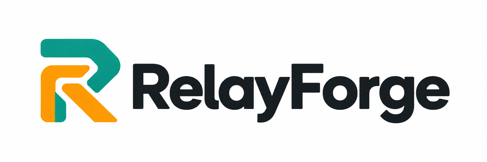
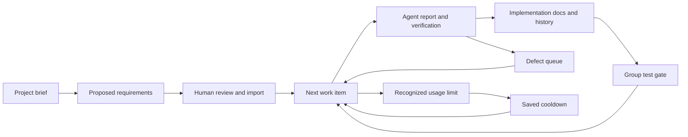

# RelayForge

<p align="center">
  
</p>

**Keep your development workflow moving when your coding agent has to stop.**

RelayForge is a local command-line tool that organizes AI-assisted development into
numbered requirements, bug repairs and verification gates. It saves the queue between
runs, gives your installed coding agent one work item at a time, and retries after a
recognized usage limit or configured cooldown.

**Release:** 0.1.0 · **Platforms:** macOS and Linux · **Python:** 3.9+ · **License:** MIT

## What you can do

- Turn a project brief into a proposed requirements checklist for human review.
- Execute approved tasks in numeric order, with bug repairs ahead of new features.
- Run configured test commands after implementation and at each requirement group's gate.
- Import human-authored changes without losing completed work.
- Keep implementation summaries, architecture notes, defect checklists and history together.
- Resume from local queue state and partial workspace edits after a normal interruption.
- Use configurable adapters for Codex, Claude Code, Grok Build, Kimi Code, Hermes or OpenClaw.

RelayForge has no runtime package dependencies or paid API of its own. Your selected
agent still requires its own installation, authentication, permissions and entitlement.

## Get started

Install RelayForge into a virtual environment:

```bash
git clone git@github.com:tulsyanlakshya009/relayforge.git
cd relayforge
python3 -m venv .venv
source .venv/bin/activate
pip install -e .
```

Initialize the **application repository you want to develop**, then edit its generated
`REQUIREMENTS.md` to describe bounded features and acceptance criteria:

```bash
relayforge --project /absolute/path/to/my-app init --agent codex
```

Configure the application's real verification commands, import its requirements, and
run one item before starting a continuous worker:

```bash
relayforge --project /absolute/path/to/my-app configure \
  --tests '[["python3","-m","unittest","discover","-s","tests","-v"]]'
relayforge --project /absolute/path/to/my-app import
relayforge --project /absolute/path/to/my-app doctor
relayforge --project /absolute/path/to/my-app tick
relayforge --project /absolute/path/to/my-app status
```

The test command above is an example for a Python application with a `tests` directory.
Use your application's actual command. Read the [getting-started guide](docs/getting-started.md)
for optional planning, agent setup, first-run review and continuous execution.

## How the workflow behaves



For example, `1.1` through `1.7` implement a feature group. `TEST-1` must pass before
ordinary work in group `2` proceeds. A new bug targeting `1.5` goes ahead of pending
feature work and causes group `1` to be tested again after the repair.

A human approves scope through imports. The worker does not automatically approve
its own proposed requirements or changes. See [workflow rules](docs/workflow.md).

## Documentation

| Guide | What you will learn |
|---|---|
| [Documentation home](docs/README.md) | Product scope, terminology and reading paths |
| [Getting started](docs/getting-started.md) | Installation through a reviewed first run |
| [Workflow](docs/workflow.md) | Requirements, priorities, changes, bugs and test gates |
| [CLI reference](docs/cli-reference.md) | Every command, option and output meaning |
| [Configuration](docs/configuration.md) | Agent selection, verification, cooldowns and prompt limits |
| [Agent setup](docs/adapters.md) | Adapter commands, permissions and workspace requirements |
| [Operations and troubleshooting](docs/operations.md) | Recovering failures, reviewing evidence and backing up state |
| [Scheduling](docs/scheduling.md) | Cron, launchd and systemd templates |
| [Architecture](docs/architecture.md) | State transitions, execution and ownership boundaries |
| [Example project](examples/README.md) | A brief, requirements and a human change entry |

## Current reliability and limits

This is an initial CLI release. The automated suite contains 39 tests and runs in GitHub
Actions on Python 3.9, 3.12 and 3.13. Tests cover the orchestrator with a local fake agent;
paid live executions across all six providers have **not** been verified.

Credit detection uses log signals and cooldowns rather than universal subscription-balance
APIs. Independent tests verify the commands you configure, not every possible acceptance
criterion. Generated implementation documentation consists of verified task summaries;
complete tutorials and API documentation are not automatically guaranteed. Native agent
session resumption, Windows support, a dashboard, automatic scheduler installation and
unattended publishing are outside this release.

## Contributing

Run the existing verification suite from this repository:

```bash
python3 -m unittest discover -s tests -v
```

Report bugs with your RelayForge version, operating system, Python version, selected agent
version, task state and relevant redacted logs. Do not include credentials or private
project code. Contributions improving real-provider behavior should include reproducible
steps and distinguish a simulated test from a live agent run.

See [CHANGELOG.md](CHANGELOG.md) for release history and [LICENSE](LICENSE) for terms.
