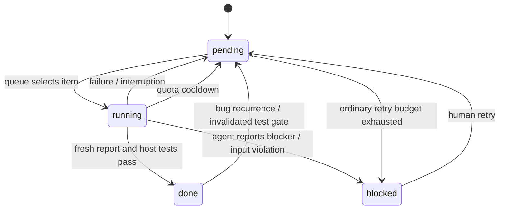

# Architecture and decisions

A `Project` owns a target workspace, private `.relayforge` directory, SQLite connection,
and a process lock. The CLI is an operator interface; adapters only translate a prompt
into argv. The core owns scheduling and completion, so switching agents does not migrate
state or reset progress.

## State machine

`tasks` stores requirement target, item type, state, priority, retries and verified summary.
`events` stores durable audit/history entries with timestamps and attempt IDs. `kv` stores
pause and reset state. Transactions commit state transitions. Atomic file replacement
renders Markdown from committed state, so an interrupted document write is recoverable
on the next tick. Source changes are intentionally not rolled back: the next prompt tells
the agent to inspect and reuse correct partial implementation.

The nonblocking POSIX file lock spans agent execution and test verification, preventing
overlapping cron jobs. A running row observed after acquiring a new lock is treated as
interrupted and returned to pending. Timeouts and Ctrl-C terminate the subprocess group.
An OS-level kill can leave grandchildren outside the runner's control; stop those before
restarting after an abnormal shutdown if necessary.

## Queue and quality gates

Numeric tuple ordering handles `1.10` correctly. Bugs preempt feature work globally;
within repairs, lower priority values win. Otherwise work stays in the earliest incomplete
requirement group. Imported changes have priority 50 and ordinary features 100. A test
gate is created once every non-planning, non-gate item in its group is done. Any later change or repair
invalidates that gate. Gates cannot run while unresolved bugs or amendments remain in
that group. Ordinary failed repairs retry the same item rather than recursively enqueueing
new repairs. Retry budgets cap unproductive loops.

Independent test commands run after each accepted non-planning completion report, including subparts,
repairs and top-level gates. Empty test configuration is allowed while drafting but prevents
a top-level gate from passing. A failing command adds a deduplicated bug except when
already repairing a bug. The agent's test-gate prompt asks it to extend and execute missing
edge-case and regression tests; test completeness still requires human review.

## Bounded context and limit handling

The master prompt defines a bounded increment and report contract. Only the current
work item, a capped design excerpt and capped completed-group context are injected.
Other files are read by the agent when relevant. This reduces orchestration overhead but
cannot control the tokens spent inside a vendor's agent loop. Reports are capped at 1 MB;
limit detection reads the final 64 KiB of the agent log. Full transcripts stream to disk.

A fresh report must match task ID and random attempt ID and include nonempty summary
and test evidence. A successful process exit does not tick an item. Common limit signals
pause without consuming ordinary retries. Explicit relative retry or ISO reset hints take
precedence over the cooldown fallback; an operator-configured reset timestamp overrides
automatic timing. A later limit may trigger another wait if the account is still unavailable.

## Ownership boundaries

The runner never imports human changes implicitly. Requirement, change and configuration
files are snapshotted before a normal attempt and restored if changed by the agent. This
is accidental-edit protection, not protection against malicious subprocesses. The SQLite
state and generated documents must not be edited by the agent. Native agent permissions
provide the execution boundary. Runtime state is local-only and Git-ignored by default.
